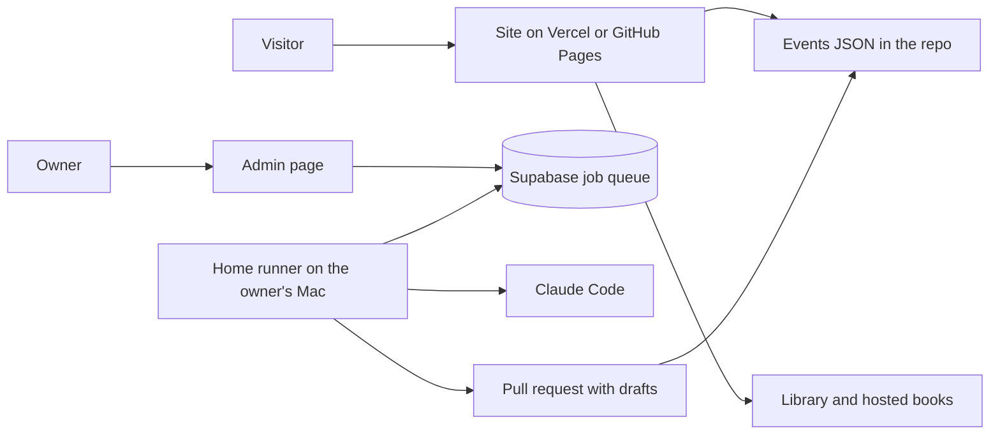
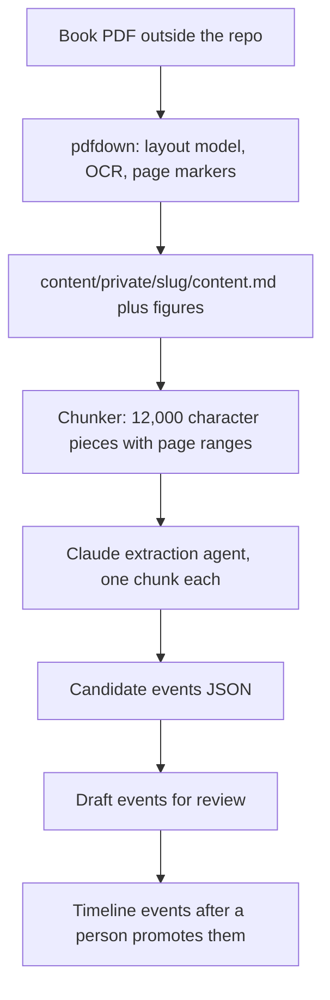
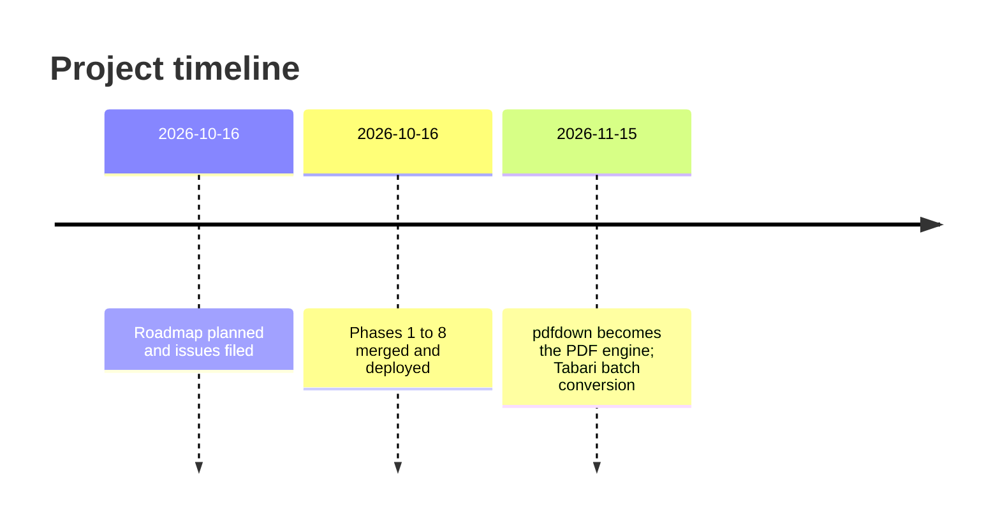

# Progress: The Chronicle of Light

An interactive web app for exploring Islamic history: a timeline and map of about 1,150 events, an Islamic Renaissance section with an open library of books and videos, and an AI pipeline that reads source books and proposes new events for a person to review.

**Status:** Roadmap phases 1 to 8 shipped (2026-10-16); all 41 source books converted with pdfdown (2026-11-15)
**Last updated:** 2026-11-17

## 1. Where we are now

The site is live at https://the-chronicle-of-light.vercel.app with a GitHub Pages mirror. All eight roadmap phases are merged into `main` [1]. The converter that turns a book into Markdown now uses pdfdown, the owner's own PDF tool, and on 2026-11-15 all 40 volumes of The History of al-Tabari plus The Muslim Conquest of Persia were converted into `content/private/` (see stage 9), ready for the chunker and the extraction agent. Two pdfdown changes that the books needed are made in the pdfdown checkout but not yet committed or released there. On 2026-11-17 the owner finished the Supabase and home-runner setup: migrations 0004 and 0005 are applied, `runner/.env` holds the new `sb_secret_` key, the runner starts and reads an empty queue, and the pipeline board holds 48 rows for 41 books. Waiting on the owner: re-enabling the nightly backup, and a decision on publishing the pdfdown changes.

## 2. Decisions

| # | Date | Decision | Why | Decided by | Recorded in |
|---|---|---|---|---|---|
| 1 | 2026-10-16 | Build the Islamic Renaissance section, open library, videos, conversion and AI pipelines as eight phases tracked in GitHub issues | The owner asked for the plan first, then the work, issue by issue | User | Roadmap issue #15, plan [2] |
| 2 | 2026-10-16 | Do not download books from Anna's Archive; host only public domain or openly licensed texts | Copyright; the session declined and the owner accepted hosting open texts instead | User | Plan [2], library schema |
| 3 | 2026-10-16 | Every book becomes Markdown before any AI reads it | One format for the reading library, the chunker and page citations | User | `scripts/convert/README.md` |
| 4 | 2026-10-16 | AI tools run only from an admin page the owner controls, on the owner's Claude subscription, through a home runner | Minimum cost, and only the owner can start a run | User | `docs/AI_JOBS.md` |
| 5 | 2026-11-15 | Convert the source books with pdfdown, the owner's own PDF to Markdown tool | The owner wants their tool used for the app's books | User | This file, stage 9 |
| 6 | 2026-11-15 | Convert the Tabari volumes with pdfdown's OCR switched off (draft) | Their text layer is complete; reading the five blank pages of one volume with OCR took 13 minutes. For the owner to confirm | Session, draft | `scripts/convert/README.md` |
| 7 | 2026-11-15 | Use Sultana's local models (Devstral on llama-server) to extract events, sort and merge them, enrich them from the internet and store them in the database, starting with a pilot on volume 35 | The owner's own agent engine; no API cost; the loop stays in code and the model answers only what it can see | User | This file, stage 10; `scripts/extract/README.md` |
| 8 | 2026-11-17 | Pause the extraction at 28 chunks and judge quality first; run the Wikipedia enrichment on those events | Spend compute only once the output is known to be good | User | Stage 10 |
| 9 | 2026-11-17 | Build the pipeline stages as buttons with live progress and counts on the admin page, reusing the Phase 7 job queue and runner; generate `PRODUCT.md` and `DESIGN.md` from the existing code rather than an interview | Start runs by clicking, watch them, keep review and the database seed manual | User | Stage 11; `docs/AI_JOBS.md` |

## 3. Stages and what was built

### Phases 1 to 8: the roadmap (done 2026-10-16)

- **What was built:** the Renaissance tab and library pages (phase 1), an importer for open resources (2), a click-to-load video player (3), the Markdown converter (4), the Claude extraction agent and pipeline with 15 events from Muir's Caliphate (5), the reading library with six hosted public domain books (6), the AI job queue with admin page and home runner (7), and the publishing guide, size budget and backup fix (8).
- **Check it yourself:** `npm run validate` ends with every event and library entry valid; `npm run build` ends with a 4 MB build under the 200 MB budget.
- **Test results:** CI green on pull requests #16 and #18 to #24, all merged on 2026-10-16 [1].
- **Changes from the plan:** the plan was first written against a stale checkout and corrected (plan [2], correction section).

### Stage 9: convert the source books with pdfdown (done 2026-11-15)

- **What was built:** `scripts/convert/index.mjs` gained a pdfdown engine (`--engine auto|pdfdown|pdfjs`, default pdfdown when installed) that keeps pdfdown's cropped figures next to `content.md` and records its notes and unfixed problems in `meta.json`. `scripts/convert/batch.mjs` converts every book in a manifest and skips the ones already done; `scripts/convert/manifests/tabari.json` lists the 40 Tabari volumes with titles and translators and the Persia book. In the pdfdown checkout: characters are now measured from the page's CropBox corner, and a `--page-markers` flag writes `<!-- page N -->` where each page starts.
- **Check it yourself:** `PDFDOWN_BIN="uv run --project ~/Projects/pdfdown pdfdown" PDFDOWN_ARGS="--ocr off" BOOKS_DIR=~/Projects/islamic_history_timeline_web_app/books npm run convert:batch -- scripts/convert/manifests/tabari.json --only tabari-volume-35 --force`, which ends with `Wrote content/private/tabari-volume-35/content.md: 72,257 words ... 202 pages`. Then `npm run extract:chunk -- content/private/tabari-volume-35/content.md` writes 59 chunks with page ranges.
- **Test results (2026-11-15):** volume 35 before the fix had 5 identical and 53 overlapping consecutive paragraphs and 9 paragraphs over 800 words; after the fix 0, 0 and 0. pdfdown unit tests: 27 passed (`uv run --extra dev pytest tests/test_units.py`). Volume 35 converts in 6 seconds from the layout cache, 34 seconds cold with OCR off. The full batch: 41 books, 11,899 pages, 4,180,109 words and 215 cropped figures in 107 MB under `content/private/`, every book with page markers; across all of them 3 duplicated paragraphs, 6 overlapping ones and 10 over 800 words remain (`npm run convert:batch`, 61 minutes for the first pass plus 4 minutes for a rerun, 2026-11-15). The first pass failed on 16 volumes because a warning printed on pdfdown's standard output sat before the JSON summary; the converter now reads the summary from where the JSON starts, and the rerun converted all 16.
- **Changes from the plan:** none planned; this stage was the owner's request on 2026-11-15.

### Stage 10: local-model extraction pilot on volume 35 (paused 2026-11-17)

- **What was built:** `scripts/extract/local.mjs` (Devstral reads each chunk through llama-server, JSON forced by grammar, streaming, split-on-cap), `merge.mjs` (grounds dates, resets ungrounded dates to the annal year, merges duplicates by rule and by one model question, drops events already on the timeline), `enrich.mjs` (Wikipedia and Wikidata match by date, context sentences from the summary only); the chunker carries al-Tabari's annal year into each chunk.
- **Check it yourself:** `npm run extract:local -- content/private/tabari-volume-35/content.md --only 012 --force` then `npm run extract:merge -- content/private/tabari-volume-35/content.md --no-model`.
- **Test results (28 of 59 chunks, 2026-11-15 to 17):** 171 candidate events, 1 chunk failed (answer cut off), median 222 s per chunk, 6.5 output tokens a second. Code checks against the chunk text: evidence quotes verbatim 69 percent plus 29 percent near-verbatim, CE year present in the text 100 percent, every date within a year of its annal, place names present 99 percent, people names present 98 percent, page number right 62 percent, 6 of 59 checkable day dates wrong by taking the Hijri day for the Gregorian one. Hand check of four chunks: 12 of 17, 4 of 4, 11 of 14, 12 of 17 events found; the misses are mostly past the 12-event cap. Merge by rule: 145 kept of 171, 15 duplicates merged, 11 already on the timeline.
- **Enrichment (2026-11-17):** the 145 merged drafts were searched on Wikipedia and Wikidata. 74 gained a licensed Wikipedia source with model-written context: 1 an article about the event itself, 73 an article about a person the text names (checked against Wikidata lifespans); 71 found nothing, mostly granular entries such as who led the pilgrimage. A first pass with a looser name rule produced 20 wrong links (name parts such as "Husayn" matching a shrine); the rule now requires every distinctive word of the person's name in the article title, and a re-check finds 1 debatable link of 73. All 1,297 events validate.
- **Changes from the plan:** the owner paused the extraction at 28 chunks on 2026-11-17 to judge quality before spending more compute; the enrichment ran on those 28 chunks' events.

### Stage 11: the pipeline as buttons on the admin page (built 2026-11-17, backend live the same day)

- **What was built:** migration `0005_pipeline.sql` (pipeline job kinds, a `pipeline_status` board readable by maintainers and written only by the runner); `runner/src/pipeline.mjs` (one handler per stage, spawning the repo's scripts with fixed arguments, reading their progress lines, heartbeating the job row and the board) and `runner/src/board.mjs` (`npm run runner:board`, rebuilds the board from disk); on the site, a **Books pipeline** tab on `/#/admin` with totals, a "Running now" block with a progress bar and time left, and a table of the 41 books with pages, chunks read, events, drafts, a stage chip and one button for the next stage. `PRODUCT.md` and `DESIGN.md` now record the product and the visual system.
- **Check it yourself:** `npm run dev` then open `/#/admin?preview=pipeline` for the screen with sample data (dev server only); `node runner/src/index.mjs --local-job job.json --no-git` with `{"kind":"draft","input":{"slug":"tabari-volume-35","title":"Volume 35"}}` runs a stage through the runner without Supabase.
- **Test results (2026-11-17):** TypeScript and lint clean (one pre-existing warning). Runner local jobs: draft stage ran in under a second; enrich stage ran in 439 s and re-attached 74 Wikipedia sources. Browser check at 1440 and 390 px: no console errors; the Next column with one button per row visible on desktop; the table scrolls inside its card on the phone; clicking a stage button without a backend shows "The backend is not configured". Impeccable's detector: one advisory (an 11 px chip size), recorded in `DESIGN.md` as a deliberate step. Security review of the changes: no findings; two hardening notes applied (child scripts get an allow-listed environment without the service key; Wikidata ids are validated before use).
- **Changes from the plan:** none. Not yet verified: the live path through Supabase, because migrations 0004 and 0005 are not applied.

## 4. Diagrams

### How the parts fit together (as of 2026-11-15)

### From a PDF book to timeline events (as of 2026-11-15)

### Timeline (as of 2026-11-15)

## 5. Findings and lessons

1. The local checkout was twelve commits behind GitHub on 2026-10-16, so the first plan was written against stale code and had to be corrected. Always fetch and compare first (plan [2], correction section).
2. pdfdown read the Tabari scans three lines out of place because every page has a CropBox 36 pt above the MediaBox corner, while the text layer uses MediaBox coordinates. Docling's layout boxes were correct; the character rebuild was not. Evidence: volume 35 had 58 duplicated or overlapping paragraphs before the fix and none after, and the Persia book, whose boxes coincide, had none either way (2026-11-15).
3. Reading blank scanned pages with OCR is slow in pdfdown 0.1.5: five pages took about 13 minutes on this Mac. With `--ocr off` the same volume converts in 34 seconds.
4. The nightly backup workflow failed every night in July and August 2026 because its secrets were empty; the fix is on `main` but no run has proved it yet (`gh run list --workflow=backup-supabase.yml`, 2026-11-15).

## 6. Open items and next step

| What | Who acts | Notes |
|---|---|---|
| Push branch `feat/pipeline-admin-board` and open a pull request | User approves, session runs | Committed locally on 2026-11-17 in three commits; not pushed |
| Create a local `.env` with `VITE_SUPABASE_URL` and the publishable key so `npm run dev` can sign in | User | Without it the local site runs read-only |
| Commit or publish the two pdfdown changes (CropBox fix, page markers) | User | Uncommitted in `~/Projects/pdfdown`; tests pass |
| Re-enable and test the nightly backup workflow | User approves, session runs | Needs the approval token |
| Close roadmap issue #15; fix issue #17 (blank timeline without WebGL) | User, then session | |
| Decide whether to run the extraction agent over the Tabari volumes | User | Costs Claude usage per chunk; volume 35 alone is 59 chunks |

**Next step:** the owner chooses a first volume for the extraction agent, or asks for the converter changes to be committed.

## 7. References

1. GitHub pull requests #16 and #18 to #24 in `rafsunsheikh/The-Chronicle-of-Light`, merged 2026-10-16.
2. `thoughts/shared/plans/2026-10-16-renaissance-library-and-ai-roadmap.md`: the roadmap plan and its correction.
3. `scripts/convert/README.md`: how the converter and the batch tool work.
4. `scripts/extract/README.md`: the four extraction stages.
5. `docs/AI_JOBS.md`: the AI job queue and home runner.
6. `~/Projects/pdfdown/tests/test_units.py`, tests `test_characters_are_measured_from_the_cropbox_corner` and `test_page_markers_mark_where_each_page_starts`: the two pdfdown changes.
